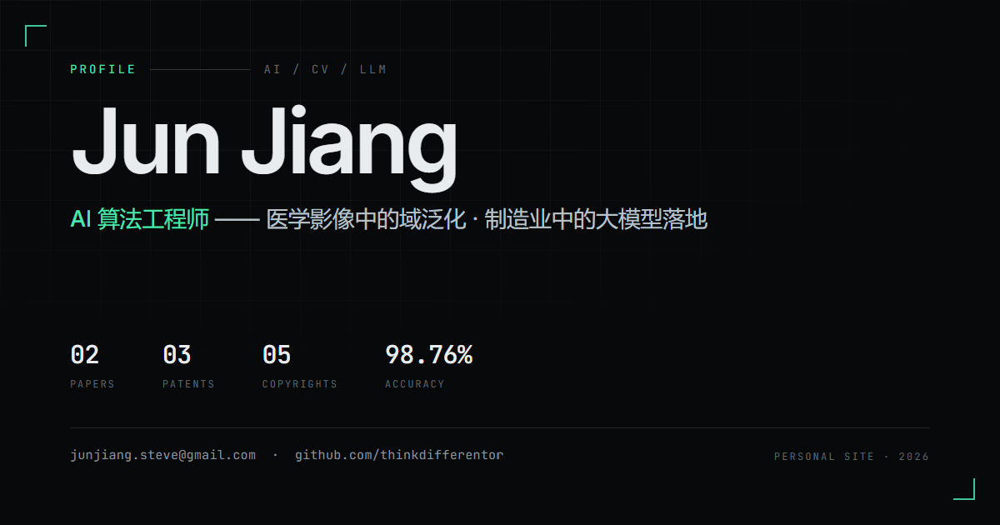
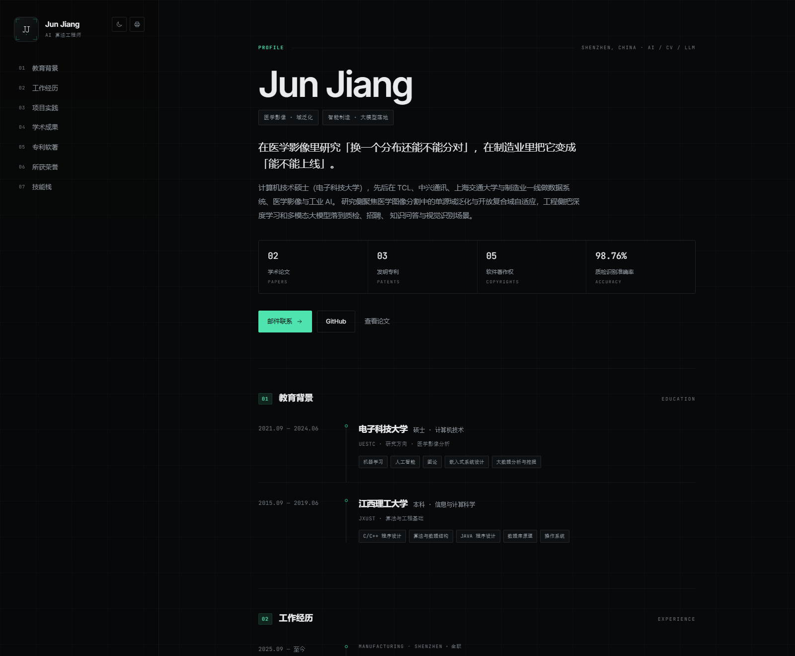
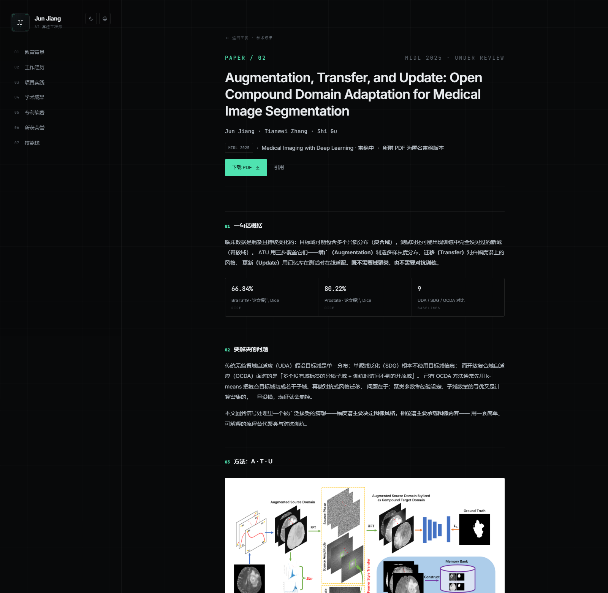

# Jun Jiang · 个人主页

一个**科技极简风格**的 Jekyll 简历主页。无需安装主题、无需前端构建工具、无需数据库，把本目录内容推到 GitHub 仓库即可通过
`https://<用户名>.github.io` 访问。



## 预览

| 首页（深色） | 论文详情页 |
| --- | --- |
|  |  |

深色 / 浅色主题可一键切换；打印时会自动切换成适合纸张的黑白排版（约 9 页）。

---

## 特点

- **零主题依赖**：只依赖 GitHub Pages 内置的 Jekyll，不使用 `remote_theme`、不使用第三方插件，构建失败风险最低。
- **原生三件套**：HTML + 纯 CSS（`assets/css/style.scss` 内是标准 CSS）+ 原生 JS，没有 npm 依赖。
- **深浅双主题**：默认跟随系统，右上角可手动切换并记忆选择。
- **内容与代码分离**：所有履历内容都在 `_data/*.yml`，改文字不用碰 HTML。
- **图文配套**：两篇论文的框架图 / 定性对比图直接从 PDF 中提取，点击可放大查看；论文页附方法解读、实验说明与 BibTeX。
- **为阅读与打印优化**：响应式布局、`prefers-reduced-motion` 适配、专门的打印样式（浏览器里「打印 / 导出 PDF」即为一份排版好的简历）。

---

## 快速部署（3 步）

### 1. 新建仓库

在 GitHub 上新建仓库，**仓库名必须是 `<你的用户名>.github.io`**（例如用户名是 `thinkdifferentor`，仓库名就是
`thinkdifferentor.github.io`）。这样访问地址就是 `https://thinkdifferentor.github.io`，不需要任何额外配置。

> 用项目仓库（如 `home_page`）也可以，但访问地址会变成 `https://<用户名>.github.io/home_page`，
> 需要按「[部署到项目仓库](#部署到项目仓库)」一节修改 `baseurl`。

### 2. 推送代码

把**本目录里的内容**（不是 `home_page` 这一层文件夹）放到仓库根目录：

```bash
cd path/to/home_page

git init
git add .
git commit -m "feat: personal homepage"
git branch -M main
git remote add origin https://github.com/<你的用户名>/<你的用户名>.github.io.git
git push -u origin main
```

### 3. 打开 Pages

仓库 → **Settings → Pages** → Source 选 **Deploy from a branch** → Branch 选 **main**、目录选 **/(root)** → Save。

大约 1 分钟后访问 `https://<你的用户名>.github.io`。之后每次 `git push`，GitHub 会自动重新构建。

> GitHub Pages 会自己运行 Jekyll，**不需要提交 `_site/` 目录**（`.gitignore` 已排除），也不需要写 GitHub Actions。

### 部署到项目仓库

若仓库名不是 `<用户名>.github.io`，编辑 `_config.yml`：

```yaml
url: "https://<用户名>.github.io"
baseurl: "/<仓库名>"
```

站内所有链接、样式、图片、PDF 都通过 `site.baseurl` 拼接，改这一处即可。

---

## 目录结构

```
home_page/
├── _config.yml              # 站点配置（标题、描述、url / baseurl）
├── Gemfile                  # 本地预览用（GitHub Pages 构建时不需要）
├── index.html               # 首页：首屏 + 7 个内容区块
├── 404.html                 # 404 页
├── papers/
│   ├── egsdg.html           # 论文页 1：EGSDG（MIDL 2024）
│   └── ocda.html            # 论文页 2：ATU / OCDA（MIDL 2025 审稿中）
├── _layouts/
│   └── default.html         # 唯一布局：左导航 + 右内容
├── _includes/
│   ├── head.html            # meta / OG / 字体 / 主题初始化
│   ├── rail.html            # 左侧固定导航栏
│   └── footer.html          # 页脚
├── _data/                   # 所有履历内容（改这里就够了）
│   ├── profile.yml          # 姓名、职位、简介、首屏数字
│   ├── education.yml        # 教育背景
│   ├── experience.yml       # 工作经历（含子项目与指标）
│   ├── projects.yml         # 项目实践
│   ├── publications.yml     # 学术论文
│   ├── patents.yml          # 发明专利
│   ├── copyrights.yml       # 软件著作权
│   ├── honors.yml           # 所获荣誉
│   └── skills.yml           # 专业技能
└── assets/
    ├── css/style.scss       # 全部样式（设计变量 + 组件 + 响应式 + 打印）
    ├── js/main.js           # 主题切换 / 复制邮箱 / 滚动高亮 / 图片放大 / 打印
    ├── img/
    │   ├── avatar.svg       # 侧栏字母标识（可换成自己的照片）
    │   ├── favicon.svg      # 站点图标
    │   ├── og-cover.png     # 社交分享预览图
    │   └── papers/          # 从论文 PDF 提取的插图
    └── files/               # 论文 PDF（EGSDG-MIDL2024.pdf、ATU-OCDA.pdf）
```

`home_page.md`、`313.pdf`、`MICCAI_24_OCDA_for_MIS.pdf` 是原始素材，已在 `_config.yml` 的 `exclude` 中排除，
**保留是为了留档，不会出现在站点里**。

> 仓库体积提示：站点实际使用的 PDF 在 `assets/files/`（已重命名为 `EGSDG-MIDL2024.pdf`、`ATU-OCDA.pdf`）。
> 上面这三份原始素材同时也写进了 `.gitignore`，**只留在本地、不会提交**，所以仓库约 7.6 MB，
> 别人也无法从 GitHub 仓库里直接下载它们。

---

## 内容维护

只改 `_data/*.yml`，页面会自动重排。几个常用字段：

| 文件 | 字段 | 说明 |
| --- | --- | --- |
| `profile.yml` | `name` / `role` / `bio` | 姓名、职位、首屏个人简介 |
| `profile.yml` | `bio` | 首屏个人简介 |
| `profile.yml` | `stats` | 首屏四个数字卡片（`value` + `label` + `label_en`） |
| `profile.yml` | `email` / `github` / `github_url` | 侧栏与联系区 |
| `experience.yml` | `subprojects` | 当前公司下的子项目，支持 `metrics`（`value` + `note`）与 `stack` |
| `experience.yml` | `bullets` | 普通条目列表（没有子项目时使用） |
| `publications.yml` | `links` | `external: true` 走外链，否则自动拼 `baseurl` |
| `publications.yml` | `image` / `image_alt` | 首页卡片配图与无障碍描述 |

注意 YAML 里**冒号后要跟空格**，包含 `: `（英文冒号+空格）的中文长句请用引号或 `>-` 折行写法，否则构建会报错。

### 换成自己的照片

- 简单做法：把照片命名为 `avatar.png`（建议 200×200 以上、正方形）放进 `assets/img/`，
  然后把 `_includes/rail.html` 里的 `avatar.svg` 改成 `avatar.png`。
- 想保留字母标识：直接改 `assets/img/avatar.svg` 里的文字与颜色。

### 新增一篇论文

1. 把 PDF 放进 `assets/files/`，插图放进 `assets/img/papers/`。
2. 在 `_data/publications.yml` 追加一条（照抄现有条目改字段即可），`key` 要唯一。
3. 复制 `papers/egsdg.html` 为 `papers/<新 key>.html`，改标题、作者、图注、摘要与 BibTeX；
   同时把 `_data/publications.yml` 里该条目的「论文详情」链接指向这个新页面。
4. 若首页卡片想用不同的状态色，在 `assets/css/style.scss` 里加一条 `.badge-<key>` 即可
   （已有 `.badge-egsdg`、`.badge-ocda` 两个示例）。

### 调整视觉

- 配色、字体、圆角、栏宽都在 `assets/css/style.scss` 顶部的 `:root` 与 `[data-theme="light"]` 里，
  改 `--accent`（主色）、`--bg`（背景）、`--max`（内容宽度）即可整站生效。
- 字体默认从 Google Fonts 加载 `Inter` + `JetBrains Mono`，若在国内加载慢，删掉 `_includes/head.html`
  里那两行 `<link>`，会回落到系统字体（中文为苹方 / 微软雅黑），布局不受影响。

---

## 本地预览（可选）

需要 Ruby（Windows 可用 [RubyInstaller](https://rubyinstaller.org/)）：

```bash
bundle install
bundle exec jekyll serve --livereload
# 打开 http://127.0.0.1:4000
```

没有 Ruby 也没关系：直接推到 GitHub，由 Pages 构建，效果一致。

---

## 常见问题

| 现象 | 原因与处理 |
| --- | --- |
| 打开是 404 | 仓库名必须是 `<用户名>.github.io`，或在 Settings → Pages 里确认分支与目录；首次构建需 1 分钟左右 |
| 页面没样式 / 图片裂了 | 部署在项目仓库却忘了把 `baseurl` 改成 `/<仓库名>` |
| 子页面 404 | 文件名大小写必须与链接一致（Linux 构建区分大小写），例如 `papers/egsdg.html` |
| 构建失败，报 YAML 错误 | `_data` 或文首 `---` 区块里有中文冒号没加引号，见上文《内容维护》 |
| 中文显示为方块 | 确认文件以 UTF-8 保存（不要用 GBK） |
| 想换域名 | 仓库根目录加 `CNAME` 文件，内容为你的域名，并在 DNS 里配置 |

---

## 说明

- 站点内的论文 PDF 与插图来自本人已发表 / 投稿的论文，用于个人主页展示；
  其中 `ATU-OCDA.pdf` 为匿名审稿版本。
- 页面中的量化指标（如 98.76%、1,200 万元 / 年）均来自原始履历，如有更新请直接改 `_data/experience.yml`。
